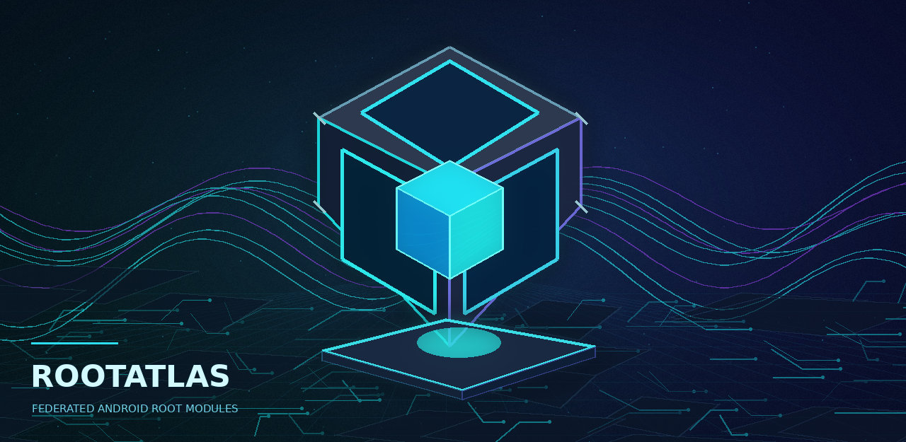

<div align="center">



<h1>Root Feed Bridge</h1>

<h3>Many repositories. Two module managers. One home.</h3>

<p>Unify trusted-source root module catalogs, independent MMRL repositories, and KernelSU Next manifests under two easy-to-add feeds. Includes the complete <strong><a href="https://krishna3163.github.io/best-root-apps-for-android/">Best Root Apps for Android</a></strong> discovery catalog, with automatic daily updates.</p>

<p>
  <a href="https://github.com/stupidgiraffe/android-root-feed-bridge/actions/workflows/update.yml"></a>
  
  
  <a href="https://buymeacoffee.com/stupidgiraffe"></a>
</p>

<p>
  <a href="#-add-to-mmrl"><strong>📦 Add to MMRL</strong></a>
  &nbsp; · &nbsp;
  <a href="#-add-to-kernelsu-next"><strong>⚡ Add to KernelSU Next</strong></a>
  &nbsp; · &nbsp;
  <a href="report.json"><strong>📊 Live coverage</strong></a>
  &nbsp; · &nbsp;
  <a href="#-support-development"><strong>☕ Support</strong></a>
</p>

</div>

---

## 📦 Add to MMRL

In **MMRL → Repos → +**, paste this **base URL** (including the trailing slash):

```text
https://raw.githubusercontent.com/stupidgiraffe/android-root-feed-bridge/main/
```

MMRL reads our [unified module index](json/modules.json) and displays both inspected Best Root Apps releases and modules from other curated MMRL repositories. The banner above also appears in MMRL's repository card.

## ⚡ Add to KernelSU Next

In **KernelSU Next → Module Repository → Manage Repositories → Add**, paste this **JSON file URL**:

```text
https://raw.githubusercontent.com/stupidgiraffe/android-root-feed-bridge/main/ksu/modules.json
```

KernelSU Next uses a different format. This feed merges our inspected single-ZIP sources with the official KernelSU Next open-source and metamodule manifests. The manager fetches each upstream repository's release when you select a module.

> [!IMPORTANT]
> The **MMRL URL is a folder**, while the **KernelSU Next URL is a JSON file**. The two are not interchangeable.

## ✨ What's inside?

| | Collection | What you'll find |
|:--:|---|---|
| 🧭 | **[Complete catalog](discovery.json)** | Original upstream entries, including root apps, Shizuku tools, LSPosed utilities, GitLab, Codeberg, Play Store links, and Morphe patched APKs |
| 📦 | **[MMRL modules](json/modules.json)** | Combined index from our inspected catalog and other MMRL repository feeds; duplicates resolved by module ID |
| ⚡ | **[KernelSU Next modules](ksu/modules.json)** | Our inspected sources plus official KernelSU Next open-source and metamodule manifests, deduped by repository |
| 📈 | **[Live coverage report](report.json)** | Exact discovery counts, successful module inspections, exclusions, and scan progress |

<div align="center">

<a href="report.json"></a>
<a href="report.json"></a>
<a href="report.json"></a>

<sub>These counts come from the live generated report, not hardcoded values.</sub>

</div>

## 🔄 How it works

```text
  Best Root Apps      MMRL official directory
  + verified ZIPs     + independent MMRL feeds
          \             /
           Normalize & deduplicate
                    |
        Unified MMRL modules.json
                    |
       +------------------------+
       |                        |
       + KernelSU Next official manifests
       |                        |
       Unified KernelSU Next modules.json
                    |
        Validate → publish daily
```

- **Daily updates:** GitHub Actions refreshes around **18:17 JST**. New repositories from MMRL's official directory are added automatically.
- **Your existing sources:** We started with the repository URLs recovered from your MMRL app, plus official discovery feeds. Your phone does **not** need to remain connected.
- **One source, one record:** MMRL deduplicates by module ID; KernelSU Next deduplicates by GitHub source repository.
- **Failure protection:** Broken JSON, missing required timestamps and failed feeds cannot invalidate the combined repository. Previously successful upstream data is cached.
- **No rehosting or automatic flashing:** Developer downloads stay upstream and nothing is installed on your phone.

**Different verification levels:** Best Root Apps ZIPs are downloaded and structurally inspected for `module.prop`. Other MMRL repositories are checked for valid JSON and required fields, **not** independently audited ZIP-by-ZIP. The official KernelSU Next manifests are sourced from their maintainers. No feed entry guarantees security, compatibility or successful installation.

### 📡 Upstream sources and transparency

- **[Configured repositories](sources/federation.json):** the curated starting set of MMRL sources, official directory URL, and KernelSU Next manifests.
- **[Coverage and source-health report](report.json):** live counts, successful feeds, failed feeds, and filtered entries.
- **[Module provenance](federation-provenance.json):** records which catalog or repository supplied each displayed module.
- **[Processing architecture](docs/ARCHITECTURE.md):** merge rules, caching, validation and limitations.

The MMRL app and KernelSU Next require **different JSON schemas**. The two import URLs above remain separate, but each is a unified repository for its manager.

<details>
<summary><strong>🔧 Maintainer information, validation and troubleshooting</strong></summary>

The repository is intentionally small and serverless.

- [Current automation status](https://github.com/stupidgiraffe/android-root-feed-bridge/actions/workflows/update.yml)
- [Coverage and exclusion reasons](report.json)
- [Architecture, data boundaries and update policy](docs/ARCHITECTURE.md)
- [MMRL JSON output](json/modules.json) · [KernelSU Next JSON output](ksu/modules.json)
- [Updater source](scripts/update.py) · [Validation source](scripts/validate.py)
- [Original source catalog](https://github.com/krishna3163/best-root-apps-for-android)

To refresh manually, open **Actions → Update Root Module Feeds → Run workflow**. If MMRL shows an older count or banner, tap **Update** on the repository card. GitHub may occasionally delay scheduled actions; the repository is intended to be hands-off, not guaranteed to require zero maintenance forever.

</details>

## ☕ Support development

<div align="center">

<p>If this bridge saves you from hunting down module downloads and checking repositories by hand, a coffee helps support future improvements and upkeep.</p>

<a href="https://buymeacoffee.com/stupidgiraffe"></a>

<br />

<a href="https://buymeacoffee.com/stupidgiraffe"></a>

<sub>Completely optional. The feeds remain free.</sub>

</div>

---

<div align="center">

<strong>Made for the Android rooting community</strong> · Maintained by <a href="https://github.com/stupidgiraffe">stupidgiraffe</a>

<sub>Catalog data belongs to its respective authors. This independent project is not affiliated with or endorsed by the source maintainer, MMRL, KernelSU Next, or module developers. Inspect what you flash.</sub>

</div>
